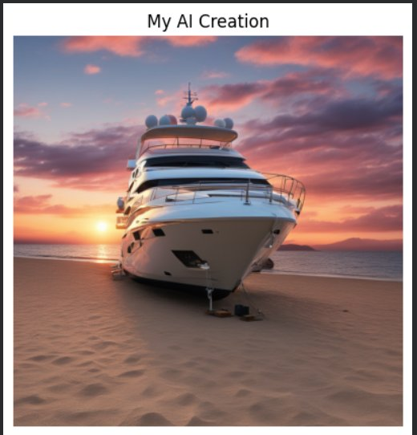

<h1 align="center">🎨 GenAI Text-to-Image Generator</h1>

<p align="center"><b>Type a sentence. Get a stunning image. That's it. ✨🖼️</b></p>

<p align="center">
  
  
  
  
  
</p>

---

## 📑 Table of Contents

- [📖 About](#about)
- [🖼️ Sample Output](#sample-output)
- [✨ What It Does](#what-it-does)
- [🛠️ Tech Stack](#tech-stack)
- [🧠 Engineering Decisions Worth Knowing](#engineering-decisions-worth-knowing)
- [📂 Project Structure](#project-structure)
- [⚙️ Prerequisites](#prerequisites)
- [🚀 How to Run It](#how-to-run-it)
- [📦 Requirements](#requirements)
- [📊 Performance](#performance)
- [🐛 Bugs I Hit and How I Fixed Them](#bugs-i-hit-and-how-i-fixed-them)
- [🗺️ What I'd Add Next](#what-id-add-next)
- [🤝 Contributing](#contributing)
- [📄 License](#license)
- [🙏 Credits](#credits)
- [👨‍💻 Author](#author)

---

## 📖 About

I built this project to explore how far you can push image quality on free hardware — specifically a T4 GPU in Google Colab 🎓. The result is a pipeline that combines two SDXL models in sequence to produce images that genuinely look good, not just "AI-generated good" 😄.

---

## 🖼️ Sample Output

Here's a real image generated with this pipeline — no post-processing, straight out of the model:

<p align="center">
  
</p>

<p align="center"><i>A luxury yacht on a sandy beach at golden hour — generated entirely from a text prompt 🌅⛵</i></p>

- **Prompt used:** `"a luxury yacht parked on a sandy beach at sunset, golden hour lighting, dramatic sky"`
- **Style:** `realistic image`
- **Negative prompt:** `"blurry, ugly, deformed, low quality, watermark"`

> 📌 This is real output from the pipeline — no editing, no cherry-picking. What you see is what the model produced.

---

## ✨ What It Does

You give it a text prompt, pick a style from a dropdown, and it generates a high-resolution image 🪄. Simple on the surface — but there's a two-stage process running underneath that makes a real difference in quality.

**🎬 Stage 1 — SDXL Base** handles the heavy lifting: it takes your prompt and generates the rough structure of the image as latent vectors (think of it as a very detailed sketch that hasn't been rendered yet) over the first 80% of the denoising steps.

**✨ Stage 2 — SDXL Refiner** picks up those latents and polishes them — adding sharpness, fine texture, and detail in the final 20%. This is what separates it from a basic single-model pipeline.

**🎨 Style options you can choose from:**

- `realistic image` — adds professional photography keywords under the hood (8K UHD, masterpiece, etc.) 📸
- `animated image` — anime/cartoon aesthetic 🌸
- `sketch type image` — pencil/line art look ✏️
- `high vfx image` — cinematic, Hollywood-grade visual effects feel 🎥
- `None` — pure prompt, no modifier

---

## 🛠️ Tech Stack

| What | Why |
|---|---|
| `stabilityai/stable-diffusion-xl-base-1.0` | Core generation model 🎨 |
| `stabilityai/stable-diffusion-xl-refiner-1.0` | Detail refinement pass ✨ |
| Hugging Face `diffusers` | Pipeline orchestration 🤗 |
| PyTorch | FP16 inference + FP32 VAE decode 🔥 |
| `ipywidgets` | Interactive style dropdown in Colab 🎛️ |
| Google Colab T4 GPU | Free hardware this was built and tested on 💻 |

---

## 🧠 Engineering Decisions Worth Knowing

### 🤔 Why sequential loading?

SDXL Base + Refiner together are too large to fit in T4 VRAM simultaneously. Instead of giving up or downgrading the model, the pipeline loads Base → generates latents → **deletes Base and clears VRAM** → loads Refiner → finishes the image → **deletes Refiner**. Both models run, nothing crashes 💪.

### 🎯 Why FP32 for VAE decode?

T4 GPUs have a known bug where FP16 precision during the final VAE decode step produces completely black images. It's a subtle issue that burned a lot of debugging time 😅. The fix is just one line — cast the VAE to `float32` before decode — but you have to know it exists.

### ⚖️ Why 80/20 denoising split?

This is the officially recommended configuration for SDXL when using Base + Refiner together. The Base builds the structure; the Refiner handles surface detail. Splitting at 80% gives each model what it's actually good at 👍.

---

## 📂 Project Structure

```
Text-to-Image-generator/
├── Text_to_image_generator.ipynb   # 📓 The full pipeline notebook
├── sample_output.png               # 🖼️ Real generated sample output
└── README.md                       # 📖 You're reading it
```

Yep, it's compact — the whole pipeline lives in one notebook on purpose, so you can open it and run end to end without hunting through modules 🧭.

---

## ⚙️ Prerequisites

Before starting, you'll need:

- 🔑 A Google account (for Colab)
- 🤗 A free Hugging Face account + access token → [get one here](https://huggingface.co/settings/tokens)
- ✅ Accept terms for both models: [SDXL Base](https://huggingface.co/stabilityai/stable-diffusion-xl-base-1.0) and [SDXL Refiner](https://huggingface.co/stabilityai/stable-diffusion-xl-refiner-1.0)

---

## 🚀 How to Run It

**1️⃣ Open the notebook in Colab**

Upload `Text_to_image_generator.ipynb` to [Google Colab](https://colab.research.google.com/) manually 📓.

**2️⃣ Switch to a GPU runtime 🎮**

```
Runtime → Change runtime type → T4 GPU
```

**3️⃣ Add your Hugging Face token as a Colab Secret 🔑**

Left sidebar → 🔑 Secrets → New secret → name it `HF_TOKEN` → paste your token.

**4️⃣ Run all cells ▶️**

```
Runtime → Run all  (Ctrl+F9)
```

> ⚠️ **Heads up:** The first cell installs libraries and deliberately restarts the session. That's expected — just keep running the cells after it comes back.

**5️⃣ Enter your prompts when asked ✍️**

```
Enter a detailed prompt: a futuristic city at night, neon reflections on wet streets
Enter a negative prompt: blurry, low quality, watermark, deformed
```

**6️⃣ Pick your style from the dropdown and run the generation cell.** The image shows up inline and saves automatically 🎉.

---

## 📦 Requirements

```txt
diffusers>=0.21.0
transformers>=4.30.0
accelerate>=0.20.0
safetensors>=0.3.0
torch>=2.0.0
ipywidgets>=8.0.0
matplotlib>=3.7.0
```

Save the list above as `requirements.txt`, then:

```bash
pip install -r requirements.txt
```

(In Colab, the notebook's first cell handles the installs for you 🛠️.)

---

## 📊 Performance

| Setting | Value |
|---|---|
| 🖼️ Output resolution | 1024 × 1024 |
| 🔢 Inference steps | 30 (24 Base + 6 Refiner) |
| ⚖️ Denoising split | 80% Base / 20% Refiner |
| 🎯 Precision | FP16 inference, FP32 VAE decode |
| 🎮 GPU memory | Fits in 16GB via sequential loading |
| ⏱️ Total generation time | ~2–4 min on T4 (model loading is the bottleneck) |

Once the models are loaded, actual inference takes about 45–90 seconds. Most of the wait is downloading and loading the model weights on first run ⏳.

---

## 🐛 Bugs I Hit and How I Fixed Them

- ⬛ **Black output images** — T4 GPUs produce all-black results when the VAE decode runs in FP16. Fix: force `vae.to(dtype=torch.float32)` before the decode step.
- 💥 **Session crashes (OOM)** — loading both SDXL models at once exceeds T4 VRAM. Fix: sequential load → generate → delete → load next.
- 👻 **Widgets disappearing after restart** — the style dropdown resets when the session restarts. Fix: added a guard that re-creates the widget if it's not found in the current session scope.

---

## 🗺️ What I'd Add Next

- [ ] 🎛️ LoRA fine-tuning for custom subjects/styles
- [ ] 🎚️ CFG scale slider for prompt adherence control
- [ ] 🖼️ Batch generation (multiple outputs per run)
- [ ] 🔄 img2img support (start from an existing image)
- [ ] 🌐 Gradio web UI for one-click Hugging Face Spaces deployment
- [ ] ⚡ SDXL Turbo for near-instant generation

---

## 🤝 Contributing

Found a bug, a better VRAM trick, or a style preset worth adding? 😄 Issues and pull requests are welcome — keep it simple and notebook-friendly, please.

---

## 📄 License

⚠️ No license file has been added to this repository yet — please contact the author before reusing the code.

---

## 🙏 Credits

- [Stability AI](https://stability.ai/) for the SDXL model weights 🎨
- [Hugging Face Diffusers](https://github.com/huggingface/diffusers) for making this approachable 🤗
- [LAION](https://laion.ai/) for the training data behind the base model

---

## 👨‍💻 Author

**Rajdeep Kumar Singh** — AI/ML engineer who likes squeezing big models onto free GPUs 🚀

- 🐙 GitHub: [https://github.com/rajdeepkumar200](https://github.com/rajdeepkumar200)
- 💼 LinkedIn: [https://www.linkedin.com/in/rajdeep-kumar-singh-ai](https://www.linkedin.com/in/rajdeep-kumar-singh-ai)
- 🤗 Hugging Face: [https://huggingface.co/rajdeepkumar200](https://huggingface.co/rajdeepkumar200)

⭐ Enjoyed it? A star helps others find the pipeline!
